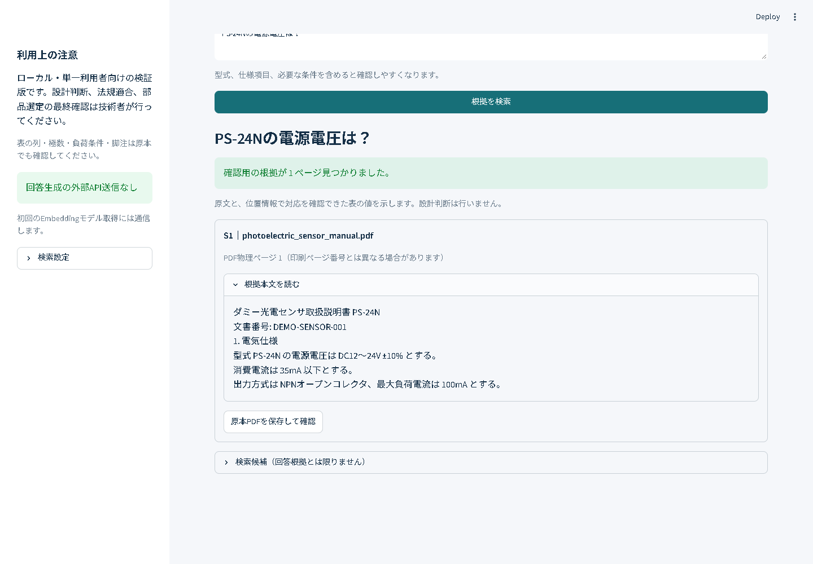

# Panel Evidence — 電気・製造業向け 技術文書検索

仕様書・取扱説明書・カタログを登録し、型式や仕様を自然言語で調べるローカルアプリです。資料名・PDFページ番号・原文・原本を確認でき、十分な根拠が見つからない質問は「登録資料からは確認できない」と返します。

**ポートフォリオ版 v0.5.2**。小規模な資料検索・根拠確認を支援します。型式省略や複雑な表・適用条件の解釈には制約があり、設計判断を代行する製品ではありません。

低圧100/200V制御盤のハード設計で経験した、客先仕様の読解・部品選定・回路設計・盤内配置・設計標準化を背景に制作しました。複数の資料を行き来して「その型式の、どの条件の仕様か」を確かめる作業を、質問から原本確認まで一つの流れにまとめています。

[営業用デモ（60秒・説明テロップ付きMP4をダウンロード）](https://github.com/213d0984-a11y/panel-evidence-portfolio/raw/refs/heads/main/docs/portfolio/demo_crowdworks_v052.mp4) · [開発目的と実務例](docs/portfolio/case-study.md) · [実測評価と限界](docs/portfolio/validation.md) · [構成図](docs/architecture.md)

デモはAPI不要の標準抜粋モードで、登録済みの自作資料・仕様検索・資料名／物理ページ／原文・根拠不足時の回答拒否を紹介します。PDFアップロード操作は映っていません。画面の「固定28問で回答可否27/28」は回答本文の完全正答率ではありません。[編集・検証レポート](docs/portfolio/video_edit/editing-report.md) · [再編集・再生成手順](docs/portfolio/video_edit/README.md) · [収録原本（85秒）](docs/portfolio/demo.webm)。

[v0.5.2の導入・画面・再起動・原本確認](docs/portfolio/handoff-v052.md) · [同版の実測集計](docs/portfolio/handoff-v052-metrics.json)

[公開版の導入・安全性確認](docs/portfolio/public-release-check.md) · [v0.5.2の評価集計](docs/portfolio/public-release-metrics.json) · [クラウドワークスの作品紹介](https://crowdworks.jp/public/employees/7061082/resumes/1286381)

## 何を解決するか

技術資料の確認では、似た型式・数値・単位・負荷条件を取り違えず、複数の資料から必要な箇所を探すことが求められます。本アプリは、検索と原本の往復を一つの画面にまとめます。

- 複数PDFを登録し、資料を横断検索
- Dense検索とBM25をRRFで統合し、型式の表記揺れを吸収
- 検索チャンクからページ本文を復元し、見出しと仕様値の分断を回復
- 対象型式・仕様項目・一部の条件を照合して回答可否を判断
- 明示的な型式列や条件列を持つ表を補助抽出し、対象・値・出典の対応を保持
- 型式の対応を証明するページも引用へ含め、別型式の値を混ぜないよう検査
- 資料名・物理ページ・根拠全文を表示し、原本PDFを保存して照合
- API不要の原文モードと、任意の外部LLM接続

## 開発で担当したこと

開発者は、電気設計の確認手順からの課題整理、要件と対応範囲の判断、実資料の選定、評価方針、原本との照合、改善結果の確認を担当しました。実装・テスト作成・調査・動画編集にはAI開発支援ツールを活用しています。

このリポジトリでは、動くアプリに加えて、初回評価の失敗、修正後の回帰結果、対応できない条件を確認できます。顧客導入や作業時間削減率は実測していません。

## 技術を選んだ理由

| 技術 | 用途と採用理由 |
|---|---|
| Python / Streamlit | PDF処理と検索の流れを少ない構成で画面化し、技術者が試せる形にする |
| PyMuPDF | ページ本文・文字座標・表を扱い、原本の位置へ戻れる根拠を保持する |
| multilingual-e5-small / Sentence Transformers | 日本語の質問と英語を含む資料を、軽量な多言語モデルで意味検索する |
| Qdrant local | サーバーを別途運用せず、文書情報とベクトルをローカルで保存する |
| BM25 / RRF | 型式・固有名詞の一致を意味検索と組み合わせ、表記揺れに対応する |
| pytest | 根拠不足・類似型式・条件や単位の取り違えを、外部API不要で回帰検査する |

LangChainは使わず、抽出・検索・根拠判定・引用検査を個別のPythonモジュールで追える構成です。

## すぐ試す（Windows / 既存のPython 3.12・PowerShell 7）

Python 3.12とPowerShell 7を用意し、GitHubの「Code → Download ZIP」で取得・展開したフォルダ直下から実行します。

~~~powershell
pwsh -NoProfile -File .\run_demo.ps1
~~~

起動スクリプトはプロジェクト内に仮想環境と依存パッケージを準備し、API不要モードで起動します。初回の依存パッケージ・Embeddingモデル取得にはネットワークが必要です。スクリプトの実行ポリシーは変更しません。組織の端末で実行が制限されている場合は、その管理方針に従ってください。

既存のPython 3.12が`py -3.12`で見つからない場合は、`-PythonExecutable`に既存のPython実行ファイルを指定できます。`-PrepareOnly`は導入だけ、`-Port`は使用ポートの指定です。Python本体は自動インストールしません。

手動で実行する場合：

~~~powershell
py -3.12 -m venv .venv
.venv\Scripts\python.exe -m pip install -e ".[dev]"
$env:RAG_DATA_DIR="data/demo"
$env:RAG_LLM_PROVIDER="extractive"
.venv\Scripts\python.exe -m streamlit run streamlit_app.py --server.address 127.0.0.1 --server.port 8765 --browser.gatherUsageStats false
~~~

ブラウザで http://127.0.0.1:8765 を開きます。

1. 「資料の登録」で「自作サンプル3冊を登録」を押す。
2. 「質問・根拠」で「PS-24Nの電源電圧は？」と質問する。
3. 根拠原文のDC12～24V ±10%と、PDF物理ページ1を確認する。
4. 「原本PDFを保存して確認」で原本を照合する。
5. 「PS-24NのBluetooth通信速度は？」で回答拒否を確認する。

自作資料は架空で、公開デモに使えます。実メーカーPDF・企業資料は同梱しません。登録できるのはテキストPDF、1冊50MB・500ページまでです。OCR、暗号化PDF、版比較、認証・権限分離は対象外です。

## 検証結果

固定28問・正解データは変更していません。

実メーカーPDF12冊・回答可能23問／回答不能5問での結果です。

| 指標 | v0.5.2 |
|---|---:|
| 回答可否正解率 | 96.4%（27/28） |
| 正解ページ取得率 | 97.8% |
| 回答不能拒否率 | 100.0%（5/5） |
| 回答可能誤拒否率 | 4.3%（1/23） |
| 厳格合格率 | 92.9%（26/28） |

厳格合格は可否・文書・ページの取得／引用一致です。数値・列・条件の意味的な完全正答率ではありません。負荷条件を証明できない比較を拒否に変え、シリーズ表記の扱いと異なる対象への複数要求を改善しました。自作資料8問も変更せず再評価し、可否・出典一致で8/8です。

原本照合で、C-06の凍結数値正解と対象列に不一致を発見しました。正解データや従来結果は変更せず、アプリは原本のセルに従います。このため厳格合格を「凍結した数値正解への完全一致」や「意味的な完全正答率」として説明しません。詳細は検証報告に記録しています。

新規メーカー資料では、PULS初回12問の可否正解83.3%・不能拒否75%に対し、問題を修正した再試験は両方100%。さらにコード固定後のMEAN WELL初回10問は可否正解90%・不能拒否100%でした。別カテゴリのFinderリレー初回8問は可否50%・不能拒否66.7%、数値型式の誤解釈等を修復した再試験は両方100%。調整後の再試験を、独立した未知初回評価として数えていません。

追加したCOSEL初回9問は可否55.6%、表の見出し・単位の取り扱いを修復した再試験は88.9%。不能3問は両方で全拒否しました。その後コアコードを固定したPhoenix Contact資料の初回7問は可否100%・不能3/3拒否です。この7問を見て検索設定やコードを調整していません。原文モードの正しいページ提示と、型式別の簡潔な数値回答の品質は区別して評価します。

評価条件、原文照合、失敗した問題、カテゴリ別結果は [検証報告](docs/portfolio/validation.md) を参照してください。独立資料の検証範囲は小さく、全製品カテゴリへの汎化を証明したものではありません。

### v0.5.1の監査修正

新規HDR-60資料の初回は可否6/8、回答可能6問中2問を誤拒否しました。また、回答した4問も全表の原文提示で、型式別の直接数値回答ではありませんでした。初回結果を残し、この8問は以後の回帰用へ昇格しました。

仕様語、明示型式列の表構造、適用条件・脚注の扱いを一般化して修正した再試験は可否8/8、型式・項目を対応付けた値の提示は6/6です。別型式への値の流用、出力電圧と調整範囲の混同、未解決の脚注を伴う回答を抑えています。PS5R-VB24は原本の75℃を保持し、注4のディレーティング参照を明示します。誤った凍結正解70℃へ合わせません。

固定28問の可否・引用指標は維持しましたが、新設した「要求する全型式・項目を構造化した値で提示できた割合」は回答可能23問中3問（13.0%）です。残りの原文提示を直接数値回答成功として数えません。この割合も、全数値・全条件の意味的完全正答率ではありません。[監査修正の詳細と再現方法](docs/portfolio/audit-v051.md) を参照してください。

## テストと再現

~~~powershell
.venv\Scripts\python.exe -m pytest --basetemp=.test-tmp -p no:cacheprovider
~~~

167件の単体・画面テストはモデル取得もAPIも不要です。依存パッケージ自体のインストールにはネットワークを使います。CI定義を同梱しています。実行済みの環境と結果は[公開版の確認記録](docs/portfolio/public-release-check.md)に示し、ローカルテストとホストCIを区別します。

動作確認環境は [tested-environment.json](docs/portfolio/tested-environment.json)。Windowsで同じバージョンを用意する場合：

~~~powershell
.venv\Scripts\python.exe -m pip install -r requirements-tested-windows.txt
.venv\Scripts\python.exe -m pip install -e . --no-deps
~~~

実モデルを使った自作資料の8問評価は、アプリを閉じて別の保存先で実行します。

~~~powershell
$env:RAG_DATA_DIR="data/sample-evaluation"
$env:RAG_LLM_PROVIDER="extractive"
.venv\Scripts\python.exe -m panel_rag.evaluation --ingest-dir sample_data/pdfs --dataset sample_data/evaluation.json --output data/sample-evaluation/report.json
~~~

メーカー資料を含む開発用の全ログはローカル作業領域に保存し、公開パッケージには集計結果だけを含めています。第三者の本文を再配布しないためです。

### メーカー資料の評価を再現する

`benchmarks/`に著作した固定質問、事実ベースの正解参照、取得元、原本のSHA-256を同梱しています。メーカー本文・PDFは含みません。原本を公式配布元から別途取得し、指定のファイル名で一つのフォルダに保存すると、次の手順で再評価できます。

~~~powershell
.venv\Scripts\python.exe scripts/evaluate_benchmark.py --dataset benchmarks/fixed28.json --documents data/documents/real_world --storage data/benchmark-fixed28 --output data/benchmark-fixed28/report.json
~~~

保存先には空の専用フォルダを指定します。既存索引の削除・上書きは行いません。PDFの改訂が一致しない場合は停止し、同じ資料であるか確認する前に採点しません。`holdout.json`、`blind.json`、`relay.json`、`cosel.json`、`phoenix.json`でも同じ手順を使えます。質問・数値の照合と引用一致は別物なので、厳格合格だけを内容の完全正答率として扱いません。

## 実装の構成

Python / Streamlit / PyMuPDF / Sentence Transformers / Qdrant local / pytest。LangChainは使用していません。

~~~text
streamlit_app.py       質問・登録・原本・品質説明
src/panel_rag/
  pdf_loader.py       PDFからページ原文を抽出
  lexical.py          型式正規化とBM25
  vector_store.py     Dense検索とRRF
  retrieval.py        ページ復元と根拠選択
  evidence.py         対象・仕様・値・条件の判定
  tables.py           明示的な型式列のセルを補助抽出
  catalog_tables.py   接頭型式と対象行、条件列を座標で結合
  matrix_binding.py   型式一覧と仕様列を明示値で一意に対応付け
  table_context.py    明示見出し・罫線の範囲と、参照された脚注の保持
  contact_tables.py   接点の取付形式・極数・負荷列を明示根拠で対応付け
  service.py          登録から引用検査までの処理
  llm.py              原文モードと外部LLM
tests/                単体・画面テスト
benchmarks/           公開可能な固定質問・事実参照・原本ハッシュ
scripts/evaluate_benchmark.py  独立取得した原本での再評価
sample_data/          自作PDFと固定のダミー評価
docs/portfolio/       ケーススタディ・評価・実画面・動画
~~~

詳しい処理と設計判断は [architecture.md](docs/architecture.md) にあります。

## 外部LLMを使う場合

標準はAPI不要の原文モードです。外部LLMは .env.example の設定で切り替えられ、質問と根拠本文を外部へ送信します。利用料金と資料の取り扱いを確認してから使用してください。外部LLMとの実通信・実回答品質は未検証です。紹介動画と掲載した性能値は標準の原文モードによるものです。

.env、APIキー、メーカー資料、索引、文書台帳をGitへ登録しないでください。初期状態は127.0.0.1だけで受け付けます。外部公開用の認証・マルチユーザー運用は実装していません。

## 制約と完成の範囲

省略型式・別名、シリーズ共通仕様の適用、結合セルや複数条件を持つ複雑な表には、誤拒否・誤読の余地が残ります。拒否は「資料に絶対にない」という断定ではありません。仕様の確認は原本と合わせて行います。

本作品は、資料検索と根拠確認の実装・検証を第三者へ提示できるポートフォリオ版です。根拠を持つ別名の照合、温度別リップルのような縦結合表、条件が文章に分散する場合は、誤拒否や条件の読み落としが残ります。原本確認を前提とし、限界を検証報告で追跡します。

公開用リポジトリは[panel-evidence-portfolio](https://github.com/213d0984-a11y/panel-evidence-portfolio)です。開発用の非公開履歴を転用せず、確認したソース・自作資料・集計結果から専用の履歴を開始しています。過去の検証報告にある「外部公開未実施」は、その検証日付時点の記録です。

## ライセンス

コードはAGPL-3.0-only。自作デモ資料を含む配布条件と依存ライブラリは [NOTICE.md](NOTICE.md) を参照してください。メーカーPDF・モデル重みは含めません。第三者資料を組み込む受託案件では、権利・機密区分・外部送信の条件を別途確認してください。
