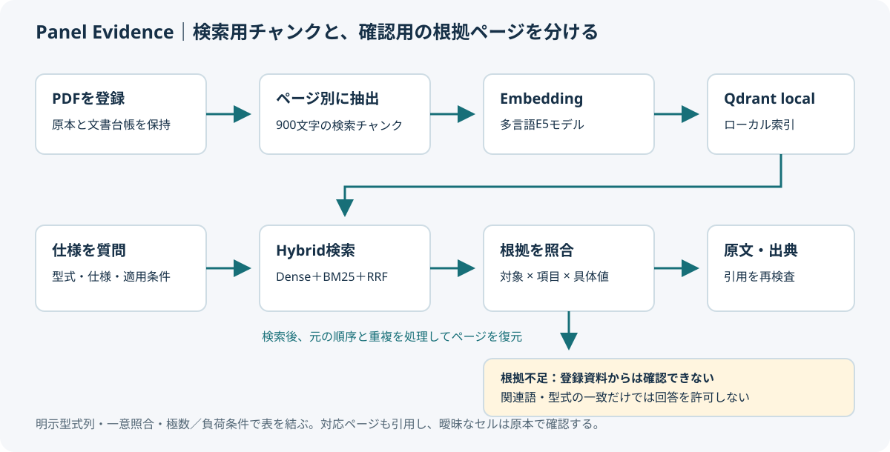
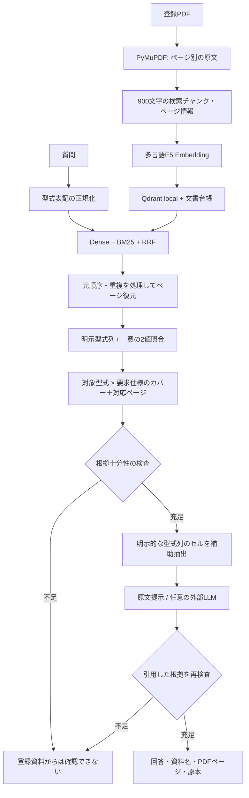

# 設計と処理の追い方

検索用の短いチャンクと、仕様を確認するためのページを分けています。見出しと数値の分断を回復しながら、モデル再登録を不要にしています。検索スコアの高さは十分な根拠の証明として扱わず、対象・項目・単位・一部条件を追加照合します。

| モジュール | 役割 |
|---|---|
| pdf_loader / chunking | 原本の読み込みと検索用チャンク化 |
| embeddings / vector_store | 数値ベクトルとHybrid候補 |
| lexical | 型式正規化、BM25 |
| retrieval | ページ復元、対象・項目のカバー |
| evidence | 仕様語彙・具体値・条件の根拠チェック |
| tables | 一意の型式列とセルの対応。空欄は推測しない |
| catalog_tables | 見出しの型式接頭部と対象行を、セル座標で結び付ける |
| matrix_binding | 型式一覧と仕様表の対応を、同一見出し・出力電圧・出力電流で一意に証明 |
| table_context | 明示MODEL文字・罫線の範囲で失われた見出しを復元し、参照脚注を保持 |
| contact_tables | 取付形式・極数の明示型式表と、接点の負荷・電圧・電流セルを一意に対応付け |
| service | 登録・質問・根拠判定・引用の処理全体 |
| llm | API不要の原文表示、外部LLMの交換点 |
| streamlit_app | 質問・登録・品質説明・原本保存 |

APIなしの原文モードでは、原文と表セルを提示します。任意の条件を完全に解釈する意味推論器ではありません。全資料の厳密な仕様比較には、対象行・条件と値の対応をさらに扱う必要があります。

ローカルQdrant索引は一つのプロセスで開きます。評価はアプリと別の保存先を使用するか、アプリを停止して実行してください。全候補走査は小規模資料セットを想定しています。

## 分割されたカタログ型式

「Catalog Code」に記された接頭部と、行ごとのコードを組み合わせて対象型式を特定できます。接頭部と接尾部の完全な対応、一意の対象行、値のセル、列を覆う見出しの座標が必要です。ND/HDなどの小見出しも値に保持します。数値のない結合セルを埋めたり、行の近さだけで別型式の値を採用したりしません。

この根拠は元の本文を書き換えず、型式・項目・条件・値・出典セル座標を持つメタデータとして保持します。原文モードは確認した値を短く提示し、原本確認用のページ全文も残します。読み取りに失敗した表からは型式リンクを作りません。

複数の要求項目のうち未解釈の項目があれば回答を控えます。単位付きなどの表示指定、容量違いや標準形などの比較対象の指定と、追加の仕様項目は区別しています。

数字とドットのみの型式は、通常の小数値と混同しないよう、質問中の「型式」「形名」「Model」「Type」直後で指定された場合に限り識別子として扱います。小数点は削除せず、類似番号や末尾の追加番号へ部分一致しません。明示ラベルのない任意の数字を型式と推定することはしません。

「型式38.51」の型式という語は対象の指定であり、要求項目ではありません。項目が解釈できないのに、対象だけ見つかったことを理由に回答しません。単位が値の前にある表では項目付近の明示的な単位を確認し、耐電圧やトルクでは扱える範囲の部位名も照合します。これは有限の仕様語彙による検査であり、任意の否定・条件を意味的に証明するものではありません。

原本・台帳・索引の同一性は内容ハッシュと文書IDで管理します。同じ表示ファイル名でも別の文書を混ぜて根拠を完成させません。登録に失敗した新規文書は索引と新規ファイルを取り消します。単一プロセスでの通常エラーを検査しており、OS停止を含む分散トランザクションの保証ではありません。

## 型式と共通仕様の対応

明示された型式列では、複数の見出し行を探し、対象型式の列を覆う値のセルだけを使います。空欄を前の値で埋めるのではなく、実際に横へ結合されたセルの範囲を確認します。

型式が仕様ページにない場合は、同じ登録原本の型式一覧から出力電圧・出力電流を読み、その2値と繰り返された見出しが一意に一致する仕様列だけに結び付けます。別の型式や別の仕様列も同じ2値を持つ場合は推定しません。型式文字列の数字から値を復号する処理はありません。元の本文、アンカーのセル、型式のセル、仕様セルの座標とページを保持します。

この対応ページもTop-Kのページ予算に含めます。型式を証明するだけのページは、仕様値へ回答を許可する根拠とは区別します。回答側が値のページだけを引用して対応ページを省略すると、引用検査で拒否します。対応ページのDenseスコアを引き上げることも行いません。

根拠不足と判定された対象の資料も、検索候補としては残します。仕様項目の新しいカバーを最優先し、その次に未取得の質問対象を優先するため、厳しい回答判定によって比較相手の資料まで失われることを抑えています。対象の存在だけで回答を許可する変更ではありません。

## 接点条件と、縦結合された仕様見出し

接点表のRated Loadという親見出しとResistive/Inductive Loadという子見出しを、値セルの列を覆う矩形で特定します。行側の取付形式・極数・NO/NCも物理セルで確認します。別ページの型式へ結ぶ場合は、その取付形式と明示極数が同じ文書内で一意に対応することを要求します。最大電力や誘導負荷の値を、抵抗負荷へ適用しません。

複数の抵抗負荷列がある場合は寿命などの注記を保持し、最大値の一つだけを選びません。根拠判定で合格した条件のfactだけを生成側へ渡します。型式対応用ページは引用元に残しますが、そこにある他型式の数値を回答本文として列挙しません。

表抽出器が複数の仕様見出しを一つの縦長セルへまとめた場合、単純な仕様行に限り、実際の文字座標と罫線付きの値セルの高さから行見出しを照合します。MODELという明示ヘッダの次の区画に限定し、同じモデル名の見出しが再出現したら区画を切ります。近い語への推測や空欄補完ではありません。単位は元の見出しから検証し、動作温度と保存温度を分離します。対応できない多段条件表は拒否し、原本確認へ残します。
